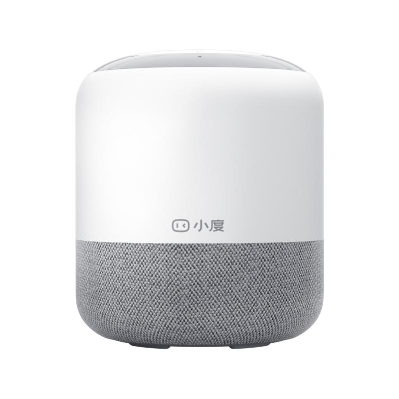
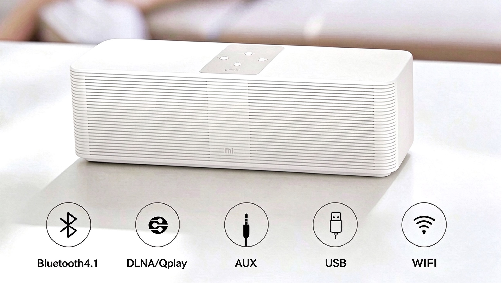

# About Me

Product-minded software engineer with 20 years of experience building and shipping software products.

Previously at Xiaomi and Baidu, contributing to product architecture, engineering, and security across consumer AI devices and enterprise software.

Built and shipped products including Mi Internet Speaker, Xiaodu Speaker, and XiaoAI Speaker. 

More recently, focused on independent AI product development, Agent systems, and AI-powered applications.

**Core Interests:** Software Architecture · AI Agents · AWS · Security (CISSP)
## Selected Products & Projects

### Mindory

**[Mindory](https://douchuan.github.io/mindory-support/index-en.html)** — An AI-powered, local-first reading and exploration application.

Built an AI-powered reading experience that helps readers explore books through natural-language questions, discover connections between ideas, and revisit relevant passages with source citations.

Designed and developed the application end to end, including desktop architecture, local RAG pipeline, vector search, and LLM integration.

### Xiaodu Speaker

**Xiaodu Speaker** — An AI-powered smart speaker developed and shipped at Baidu, featuring voice interaction and smart home control.

### Mi Internet Speaker

**Mi Internet Speaker** — A wireless smart speaker developed and shipped at Xiaomi, supporting Bluetooth, DLNA/QPlay streaming, AUX input, and USB playback.

### AI Audiobook Project

**[AI Audiobook Project](https://m.ximalaya.com/album/131945407?from=pc)** — An AI-assisted audiobook production project focused on bringing classic short fiction to life.

Developed an AI-driven production workflow covering script segmentation, character-specific voice casting, emotional expression, speech pacing, and scene sound effects.